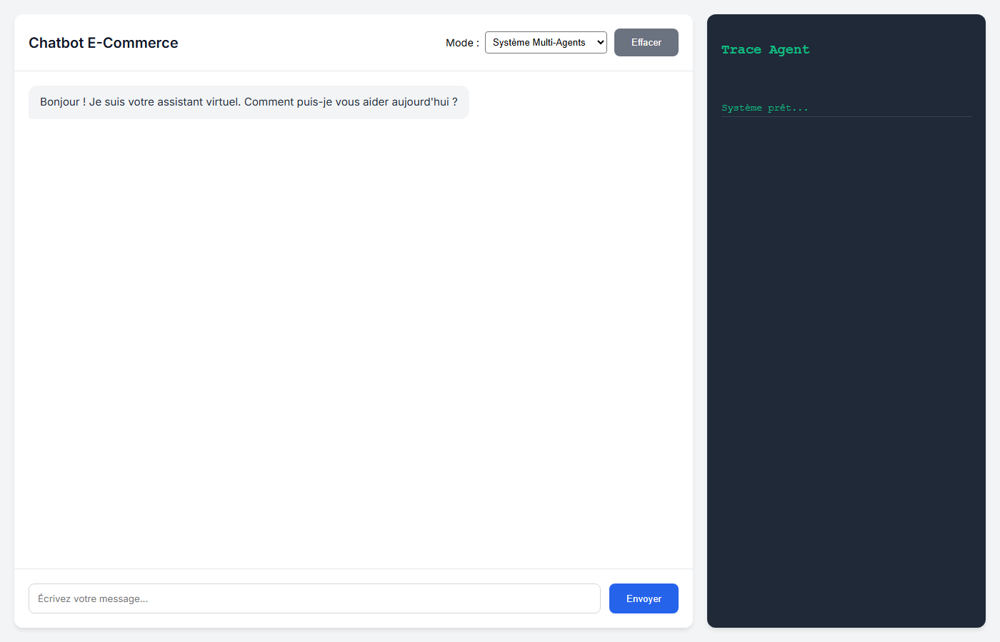

# Multi-Agent Chatbot

Customer-service assistant for a small online electronics shop, built for the NLP module
at CY Tech (ING3, 2025-2026). The user writes in French (or English, the answers are in
French), an orchestrator decides whether the message is about buying something, about an
existing order, or just small talk, and hands it to a sales agent or a support agent. Both
agents run on Llama 3.3 70B through the Groq API, with LangChain, and can call tools that
query a MariaDB database: catalogue, stock, promotions, reviews, clients, orders,
deliveries, invoices, warranties. A Flask server exposes everything as a REST API and
serves a small web UI with a trace panel showing which agent answered and which tools it
called.



## How it works

```
browser / curl
     |  POST /api/chat {message, conversation_id, mode}
     v
server.py (Flask)
     |
     v
agents/orchestrator.py   routing prompt -> SALES / SUPPORT / GENERAL
     |                   keeps the last 10 messages per conversation_id
     +-- SALES   -> agents/sales.py    5 tools: search, details, stock, promotions, reviews
     +-- SUPPORT -> agents/support.py  7 tools: client by reference or email, orders,
     |                                 order details, delivery, invoice, warranty
     +-- GENERAL -> plain chat answer
                        |
                        v
              core/database_mysql.py   parameterised SQL, MariaDB in Docker
```

Routing is one LLM call with a short prompt and the last four messages as context, so a
follow-up question stays with the same agent. Each agent is a system prompt plus a list of
LangChain tools (`agents/base.py`): the model is called with the tools bound, the tool
calls it returns are executed and their results fed back, up to four rounds, then the
final text goes back to the user. The prompts insist on short French answers and on never
inventing a price or an order status when a tool returns nothing. Memory is one window of
the last 10 messages per `conversation_id`, shared by both agents, so a conversation can
move from sales to support without losing what was said.

The UI also has a "baseline" mode: same model, one call, no routing, no tools. It is there
to show what the agents add; the baseline cannot check a stock or an order.

## Repository

```
agents/       base.py (tool loop + memory), orchestrator.py, sales.py, support.py
core/         database_mysql.py (all the SQL), llm_provider.py (Groq model factory),
              context_manager.py, smart_extractor.py (utilities, see limitations)
forms/        form_manager.py (multi-step forms with validation, not wired yet)
db/           ecommerce.sql (schema + data: 21 tables, 38 products, 6 clients, 15 orders),
              seed_extra.sql (deliveries, warranties, reviews, payments)
server.py     Flask API: /api/chat, /api/history, /api/clear, /api/health
templates/, static/   web UI
tests/        test_tool_loop.py (offline), test_all_scenarios.py, scenarios.json
docs/         database_functions.md, agent_scenarios.md, screenshots/
```

## Running it

You need Python 3.10+, Docker (MariaDB and phpMyAdmin run in containers) and a Groq API
key (free tier at https://console.groq.com).

```bash
pip install -r requirements.txt
cp .env.example .env          # put your GROQ_API_KEY in it
docker compose up -d          # MariaDB on localhost:3308, seeded on first start; phpMyAdmin on :3009
python server.py              # http://localhost:5000
```

`make help` lists the same steps as Make targets. If a database volume already exists from
an earlier run, `make db-init` reloads the two SQL files into the running container.

The API takes JSON and returns `response`, `agent` (SALES, SUPPORT, GENERAL or BASELINE),
`tools_used` and a `trace`:

```bash
curl -X POST http://localhost:5000/api/chat -H "Content-Type: application/json" \
  -d '{"message": "Où en est ma commande CMD-2026-0002 ?", "conversation_id": "demo"}'
```

Test data to try: orders `CMD-2026-0001` to `CMD-2026-0015`, client reference
`1000000000123`, email `alice.martin@gmail.com`, products such as "iPhone 15", "Dell XPS",
"PlayStation 5".

## Tests

`python tests/test_tool_loop.py` runs offline, without a key or a database. It replaces the
model with a scripted fake and checks that tool calls are executed and their results fed
back, that unknown tools and model errors are handled, that the memory window is 10
messages and kept per conversation, and that the routing decision is parsed correctly
(6 tests).

`python tests/test_all_scenarios.py` sends 15 scripted questions (the English originals are
in `tests/scenarios.json`, the French versions in the script) to a running server and
checks, for each answer, that the expected agent handled it and that the reply is short,
non-empty and free of technical vocabulary. It needs the full stack and a Groq key. When we
ran the scenarios at the end of the project (January 2026), all 15 produced a valid short
French answer; the runner at that time did not check which agent had answered, so I have
no routing accuracy figure to report. The current runner does check it and writes a JSON
report to `tests/results/`.

## Limitations and what I would do next

- Everything depends on the Groq API. There is no local model fallback; without a key the
  server starts but `/api/chat` answers 503.
- Memory lives in the server process and is lost on restart. Clients are identified by
  typing a reference or an email; there is no authentication.
- `core/context_manager.py`, `core/smart_extractor.py` and `forms/form_manager.py` were
  written for progressive data collection (ask for the order number, validate it, keep it
  in the context) but are not plugged into the request path yet; the agents rely on the
  prompt to ask for missing information. Wiring the form manager into the support agent is
  the first thing I would do.
- Tool arguments come from the model. When the user gives a product name instead of an id,
  the agent has to search first, which costs an extra round trip.
- The scenario runner checks the shape of the answer and the routing, not the facts. A real
  evaluation would compare the tool results with the answer text.
- Promotions have fixed dates in the seed data, so the active promotions depend on today's
  date.

## Context

NLP module project, CY Tech ING3, 2025-2026, done with Amine Filali. Amine set up the first
version (Flask server, web page, first orchestrator, sales and support prompts over a SQLite
prototype). I wrote most of the implementation after that: the MariaDB schema and data
layer, the agents' tools and tool loop, the orchestrator and its memory, the Docker setup,
the test scripts and the documentation.
