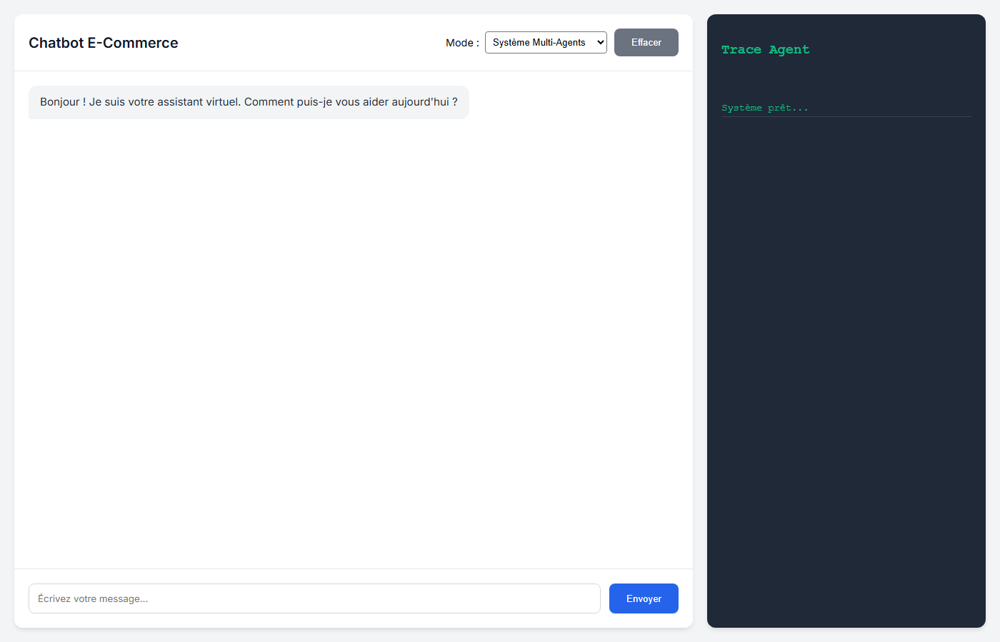

# Multi-Agent Chatbot

Customer-service assistant for an online electronics shop, in French. An orchestrator reads each message and hands it to a sales agent or a support agent. Both agents run Llama 3.3 70B through the Groq API with LangChain and query a MariaDB database through tools.



## What it does

- Routes each message to sales, support or small talk, with a 10-message memory per conversation.
- Sales agent: product search, details, stock, promotions and reviews (5 tools).
- Support agent: client lookup, orders, deliveries, invoices and warranties (7 tools).
- Answers only from tool results: no invented price or order status.
- REST API and a small web page with a trace of the agent and the tools it used.

## How it works

```
POST /api/chat  ->  Flask (server.py)
                    -> orchestrator: one LLM call decides sales / support / general
                       -> agent = system prompt + LangChain tools, up to 4 tool rounds
                          -> core/database_mysql.py: parameterised SQL on MariaDB (21 tables)
```

A "baseline" mode (one call, no routing, no tools) is kept for comparison: it cannot check a stock or an order.

## Run it

Python 3.10+, Docker and a Groq API key (free tier).

```bash
pip install -r requirements.txt
cp .env.example .env        # GROQ_API_KEY
docker compose up -d        # MariaDB seeded on first start, phpMyAdmin on :3009
python server.py            # http://localhost:5000
```

```bash
curl -X POST http://localhost:5000/api/chat -H "Content-Type: application/json" \
  -d '{"message": "Où en est ma commande CMD-2026-0002 ?", "conversation_id": "demo"}'
```

Test data: orders `CMD-2026-0001` to `CMD-2026-0015`, client email `alice.martin@gmail.com`, products such as "iPhone 15" or "PlayStation 5".

## Tests

- `python tests/test_tool_loop.py`: 6 offline tests with a scripted model (tool loop, error handling, memory window, routing parser).
- `python tests/test_all_scenarios.py`: 15 scripted conversations against a running server. In the January 2026 run all 15 returned a valid short French answer; routing accuracy was not measured.

## Limitations

- Depends on the Groq API; without a key the server starts but `/api/chat` answers 503.
- Memory lives in the server process and is lost on restart; there is no authentication.
- The form manager (progressive data collection with validation) is written but not wired into the support agent yet.

NLP module project, CY Tech, 2025–2026, with Amine Filali. Amine set up the Flask server, the web page and the first orchestrator prompts; I wrote the database schema and data layer, the agents' tools and tool loop, the memory, the Docker setup, the tests and the documentation.
